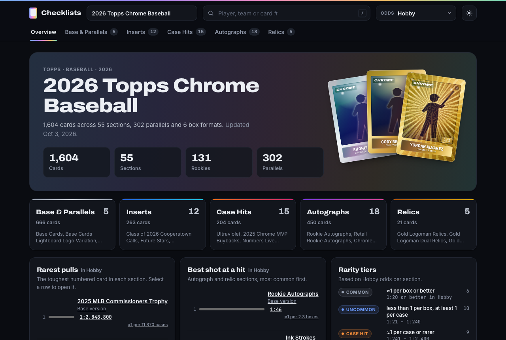

# Topps Checklists

A fast, static website for browsing Topps trading-card checklists, split the way collectors
think about a release: **Base & Parallels**, **Inserts**, **Case Hits**, **Autographs** and
**Relics**, with the pack odds for every box format.

**Live site: <https://brand1345.github.io/topps-checklists/>**

Each set is built from the two PDFs Topps publishes for it (the checklist and the odds sheet).
Adding next year's release means dropping in two files and running one command, with no code changes.



## Features

- **Tabs per category**: Overview · Base & Parallels · Inserts · Case Hits · Autographs · Relics.
- **Format picker** (Hobby, Jumbo, Mega, …). Odds everywhere follow the selected format, with
  "≈ 1 per N boxes / cases" when the box configuration is known.
- **Parallel "rainbow" chips** sorted by rarity. Hover, focus or tap one to preview an example card
  (a real image if you add one, otherwise a generated card in that parallel's colour and finish)
  along with its odds in every format.
- **Rarity tiers** (Common, Uncommon, Case Hit, Ultra) worked out from the odds and the box/case
  configuration. Rare inserts land in **Case Hits** automatically.
- **Search** across players, teams, card codes and sections.
- Light and dark themes, works on phones, keyboard accessible. The site is plain HTML, CSS and JS
  with no framework and no build step.

## Quick start

You need Python 3.9 or newer, `git` and `make`. On macOS, run `xcode-select --install` once if
`make` is missing.

```sh
git clone https://github.com/brand1345/topps-checklists.git
cd topps-checklists
make setup    # create .venv/ and install the two dependencies (pdfplumber, pyyaml)
make build    # sets/*/ PDFs -> site/data/*.json + reports/*.md
make serve    # open http://localhost:8765/
```

| Command | What it does |
|---|---|
| `make setup` | Create the `.venv/` virtualenv and install `requirements.txt` |
| `make build` | Build every set (`make build SLUG=<slug>` builds one) |
| `make test` | Run the unit tests (`python -m unittest discover -s tests -v`) |
| `make check` | Run the tests, then build every set. This is what the deploy runs, so run it before `git push` |
| `make serve` | Serve `site/` on port 8765 (`make serve PORT=9000` to change it) |
| `make new SLUG=… CHECKLIST=… ODDS=… [NAME=…]` | Scaffold a new set from its two PDFs |
| `make ids SLUG=…` | List a built set's section IDs and the image file name for every parallel |
| `make inspect PDF=… [ARGS=…]` | Print what the parser sees in one PDF. A checklist shows its column boundaries and each section's card count; `ARGS=--cards` also lists every card, and `ARGS=--lines` every line. An odds PDF shows its formats and every row |
| `make fixtures` | Build every product in the local `fixtures/` folder (data to `fixtures/_out/`, reports to `fixtures/_reports/`) |
| `make clean` | Delete generated data, reports and caches |

Running `make` on its own prints this list. Every target wraps the CLI (`python -m pipeline …`),
so you can also call the CLI directly.

### CLI reference

Run these from the repo folder with the virtualenv's Python (`.venv/bin/python -m pipeline …`).
Default folders are relative to the repo.

```
python -m pipeline build [SLUG ...] [--sets-dir DIR] [--out-dir DIR] [--reports-dir DIR]
python -m pipeline new SLUG --checklist PDF [--odds PDF] [--name NAME] [--sets-dir DIR]
python -m pipeline inspect PDF [--kind {auto,checklist,odds}] [--lines] [--cards]
```

| Command / flag | Meaning |
|---|---|
| `build` | Builds the listed sets, or every folder in the sets directory whose name doesn't start with `.` or `_`. Writes `<slug>.json` and the `sets.json` index to the output folder, and `<slug>.md` to the reports folder. When building everything, a folder with no checklist PDF is skipped, and the generated files of sets whose folder no longer exists are deleted. Exits with status 1 if any set fails (including a set you named that has no checklist PDF). |
| `--sets-dir` | Folder of set folders (default `sets/`) |
| `--out-dir` | Where the JSON goes (default `site/data/`) |
| `--reports-dir` | Where the reports go (default `reports/`) |
| `new` | Copies the PDFs to `<sets-dir>/<slug>/checklist.pdf` and `odds.pdf` and writes a starter `set.yaml`. Stops if that `set.yaml` already exists. |
| `--checklist` | The checklist PDF (required) |
| `--odds` | The odds PDF. Optional; without it the set builds with no odds, parallels or tiers until you add `odds.pdf` to the folder |
| `--name` | The set name. If you leave it out, the name is detected from the PDF title |
| `--sets-dir` | Where to create the set folder (default `sets/`) |
| `inspect` | Prints a debug dump of one PDF |
| `--kind` | `auto` (default) guesses from the first page: landscape with odds values means odds, otherwise checklist |
| `--lines` | Checklist only: every line with its page, y-position and how it was classified |
| `--cards` | Checklist only: every card (code, players, teams, RC) under its section |

`make build`, `make new` and `make inspect` call the first three. `make fixtures` calls
`build --sets-dir fixtures --out-dir fixtures/_out --reports-dir fixtures/_reports`, then runs
`inspect` on the PDFs in any fixture folder that has no checklist.

## How the repo is organised

```
sets/<slug>/          one folder per set: checklist.pdf, odds.pdf, set.yaml, images/ (optional)
pipeline/             Python package: PDFs -> JSON (python -m pipeline build | new | inspect)
site/                 the static site (index.html + assets/); site/data/ is generated
reports/<slug>.md     generated parse/match report for each set; read it after every build
tests/                unit tests
fixtures/             local-only PDFs from other Topps products for robustness testing (gitignored)
docs/SPEC.md          the contract between pipeline and site
docs/ADDING_A_SET.md  step-by-step guide for adding a set
```

The pipeline reads a set's two PDFs. It then matches each odds row (for example
`BASE CARDS GOLD REFRACTOR`) to a checklist section and parallel, and classifies every section into a
tab and a rarity tier. The result goes to `site/data/<slug>.json`, which the site renders. When the
pipeline gets something wrong, you fix it in that set's `set.yaml` and never in the generated JSON.

The JSON schema, `set.yaml` options, matching rules, tier thresholds, image naming and site routes
are all defined in **[docs/SPEC.md](docs/SPEC.md)**.

## Deployment (GitHub Pages)

The site is live at **<https://brand1345.github.io/topps-checklists/>**. It deploys through GitHub
Actions ([.github/workflows/deploy.yml](.github/workflows/deploy.yml)) from
[github.com/brand1345/topps-checklists](https://github.com/brand1345/topps-checklists).

1. In the repo, go to **Settings → Pages → Build and deployment → Source** and choose
   **GitHub Actions** (one-time setup).
2. Push to `main`, or open the **Actions** tab, pick **Deploy site** and click **Run workflow**.

Each run installs the dependencies, runs the tests and runs `python -m pipeline build`, the same
steps as `make check`. If all of them pass, it uploads `site/` and publishes it. A failing test or a
set that fails to build stops the deploy, and the live site keeps the previous version. The data is
rebuilt from the PDFs in `sets/` on every deploy, so the live site always matches what is committed.
The gitignored `site/dev-data/` and `fixtures/` folders are never needed or shipped.

## Add a new set

```sh
make new SLUG=2027-topps-chrome-baseball CHECKLIST=~/Downloads/checklist.pdf ODDS=~/Downloads/odds.pdf
make build
# read reports/2027-topps-chrome-baseball.md and fix anything in sets/2027-topps-chrome-baseball/set.yaml
make serve
make check    # the same tests and build the deploy runs; it must pass before you push
git add sets/2027-topps-chrome-baseball && git commit -m "Add 2027 Topps Chrome Baseball" && git push
```

The full walkthrough is in **[docs/ADDING_A_SET.md](docs/ADDING_A_SET.md)**. It covers reading the
report, fixing odds rows with aliases and overrides, setting box/case configuration and adding
example card images.

---

This is an unofficial fan project and is not affiliated with Topps. The checklists and odds come
from the PDFs Topps publishes, and each set's data keeps Topps' own disclaimer. Actual pack contents
and odds may vary.
